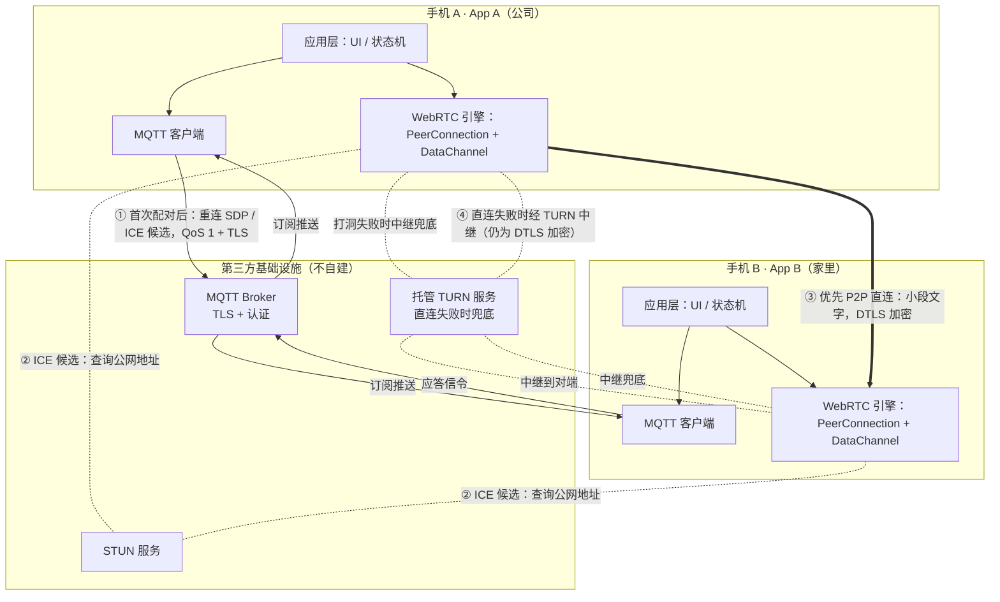

# WebRTC + MQTT + SDP 点对点通信方案

## 1. 概述

本方案实现两个 Android 设备之间的小段文字通信。两台设备首次处于同一网络时手动交换 SDP 建立连接；之后设备进入不同网络时，通过 MQTT 自动交换 ICE Restart 信令恢复连接。App 在通信期间保持前台并保持联网。

### 1.1 核心原则

- **数据链路**：WebRTC DataChannel 发送小段文字，优先尝试点对点直连
- **信令通道**：首次手动交换 SDP；绑定后由 MQTT 传递后续 SDP 和 ICE 候选
- **NAT 穿透**：STUN 辅助发现地址；直连失败时使用第三方托管 TURN 作为中继兜底
- **不自建中继**：MQTT Broker、STUN 和 TURN 均使用第三方服务；TURN 中继会转发加密后的 DataChannel 流量

### 1.2 适用场景

- 两台 Android 设备首次位于同一网络，之后可能分别处于公司 Wi-Fi 与家庭 Wi-Fi
- 只传输小段文字，不传图片或大文件
- App 在通信期间始终位于前台并保持联网
- 首次通过二维码/文本绑定并手动交换 SDP；后续依赖 MQTT 自动重协商
- 可接受直连失败时由第三方托管 TURN 中继兜底

---

## 2. 整体架构



| 路径 | 类型 | 内容 | 是否经过服务器 |
|---|---|---|---|
| ① MQTT | 信令流 | SDP + ICE 候选 | 经过第三方 MQTT Broker（应启用 TLS 和认证） |
| ② STUN | 地址发现 | 查询公网映射地址，不转发业务数据 | 经过第三方 STUN 服务 |
| ③ DataChannel 直连 | 业务数据流 | 小段文字 | 设备间直传，不经过中继 |
| ④ TURN 兜底 | 中继数据流 | 直连失败时转发加密数据 | 经过第三方托管 TURN 服务 |

---

## 3. 完整链路分阶段拆解

### 阶段 0：准备与配对初始化

目的：建立绑定关系、固定协商角色，并准备后续自动重连所需的信令通道。

1. App A 生成随机 `roomId`（16 字节随机值的 Hex 编码，32 字符）和 `preSharedKey`（32 字节随机密钥）：
   ```
   roomId = "a3f1b2c4d5e6f708091a2b3c4d5e6f70"   // 16字节随机 → hex，防扫描枚举
   preSharedKey = "k9f2a1b3..."                   // 32字节（256-bit），用于信令 AES-GCM 加密
   ```
2. App A 显示二维码（或文本），内容包含 `roomId`、`preSharedKey`、邀请方 `deviceId` 及 Broker/信令配置。不要把 Broker 密钥等服务端凭据放入二维码。
3. App B 扫码/输入后回传自己的稳定 `deviceId`，两端完成绑定并按两个设备 ID 确定角色。
4. 绑定后，两端连接 MQTT 并订阅 `c2c/{roomId}/signal`，本地保存对方设备标识、`preSharedKey`、`roomId` 和固定角色。角色由两端稳定且唯一的 `deviceId` 字典序比较确定，较小者为 offerer。
5. 确认 MQTT 信令可用后，首次连接通过可信渠道手动交换 SDP。由于手动交换没有逐条 trickle 候选通道，双方应等待 ICE gathering 完成后再导出并交换完整 SDP（含候选）；或明确提供手动交换候选的步骤。二维码用于配对信息，不建议承载完整 SDP。

### 阶段 1：首次手动交换 SDP，建立 WebRTC 连接

首次连接使用手动 SDP，不依赖 MQTT 完成初始协商。由于两端同处一个网络，可能通过局域网候选建立连接；这并不代表之后跨网络也一定能直连。

1. 两端均已绑定并连接 MQTT，以便未来切换网络后使用自动信令。
2. 固定 offerer 创建 `RTCPeerConnection`，配置 STUN 和托管 TURN，并创建可靠、有序的 DataChannel。
3. Offerer 创建 offer、设置本地描述，并等待 ICE gathering 完成后导出完整 SDP。
4. 两端通过 UI 展示/输入、复制粘贴等可信方式手动交换完整 offer/answer SDP；Answerer 设置远端 offer、创建并设置 answer，等待 ICE gathering 完成后导出 answer。
5. Offerer 设置收到的 answer。双方等待 ICE 状态和 DataChannel 状态确认连接成功。

> 手动复制完整 SDP 会暴露其中的 ICE 地址与候选，只应通过可信的设备间渠道交换。若使用不含候选的 SDP，就必须另行手动交换 ICE 候选，否则初次连接可能无法建立。

### 阶段 2：日常数据收发

连接建立后，所有业务数据通过 DataChannel 传输，不再使用 MQTT。

#### 文字传输

以 UTF-8 通过 DataChannel 发送文字。保持 DataChannel 为默认的可靠、有序传输；若未来设置部分可靠模式，应另行设计应用层确认与重试。

### 阶段 3：网络切换 / 连接断开后的自动重连

这是方案的核心场景：设备离开初次连接的同一网络后，原 ICE 路径可能失效。两端仍以前台运行并保持联网为前提，通过 MQTT 自动交换新的 SDP 和 ICE 候选，无需再次人工交换 SDP。

> 先尝试在已有 `RTCPeerConnection` 上进行 **ICE Restart**。DataChannel 通常可随 ICE 恢复继续使用，但不保证所有失败状态都能恢复；超时后应允许重建 PeerConnection 并重新协商。

1. **检测网络变化 / 连接断开**
   - 通过 `ConnectivityManager` 监听 Wi-Fi 或蜂窝网络切换
   - 或 WebRTC `PeerConnection.Observer` 回调 `onIceConnectionChange(DISCONNECTED / FAILED)`
   - 可选的应用层心跳超时（见 6.8 节）

2. **防抖处理**
   - 网络切换时 `ConnectivityManager` 可能短时间内触发多次回调，导致频繁创建连接
   - 设置 **3 秒防抖窗口**，窗口内多次回调只触发一次重连

3. **触发 ICE Restart**（仅 offerer 端发起，见 7.4 角色约定）
   - 只由固定 offerer 发起，且确保当前没有未完成的 SDP 协商
   - 创建 ICE Restart offer；在 `setLocalDescription` 成功后通过 MQTT 发布新的 `reconnect_offer`
   - 新的 ICE 候选逐条通过 MQTT 推送，并带上本轮协商 ID
   - 所有动态信令均使用 `retained = false`，避免重连后收到过期协商：
   ```json
   { "type": "reconnect_offer", "from": "device_A_id", "negotiationId": "随机协商 ID", "sdp": "ICE Restart 的新 offer SDP..." }
   ```

4. **对端收到后自动应答**
   - App B 收到与当前绑定匹配的新 `reconnect_offer`
   - 设置远端 SDP 成功后，处理此前缓存的同轮 ICE 候选，再创建 answer
   - `setLocalDescription` 成功后发布 `reconnect_answer`，并继续传递本轮 ICE 候选

5. **重建连接**
   - A 收到并设置同一 `negotiationId` 的 answer，两端重新进行 ICE 连通性检查
   - DataChannel 恢复后回到"已连接"状态；超时则进入失败恢复流程，不假设通道必然无感恢复

```
同一网络首次手动建连 ── 两台设备分别切换到公司/家庭网络
        │
        ├─ 连接断开，检测网络变化
        │
        ├─ 防抖 3 秒 → ICE Restart 生成新候选
        │
        ├─ 通过 MQTT 自动发送新 SDP + ICE 候选（均不 retained）
        │
        └─ 对端自动应答 → 重新建立 P2P 连接
```

### 阶段 4：失败处理

如果直连打洞失败，ICE 应尝试第三方托管 TURN 中继。若直连和 TURN 路径均失败，重连仍可能失败。此时：

- 明确提示："当前网络环境无法建立连接，请检查网络后重试。"
- 保留绑定关系，不删除 `roomId` 和共享密钥
- 使用有上限的退避策略重试，或等待网络再次变化后重试

---

## 4. MQTT 信令协议设计

### 4.1 主题设计

```
c2c/{roomId}/signal
```

两端订阅同一主题，通过消息体中的 `from` 字段过滤自发消息。

> **自发消息过滤**：两端订阅同一主题会收到自己发的消息，必须通过 `from` 字段与本地 `deviceId` 比较来丢弃。

### 4.2 消息格式

```json
{
  "type": "reconnect_offer | reconnect_answer | ice_candidate | bye",
  "from": "device_id",
  "negotiationId": "每轮协商随机生成",
  "messageId": "每条信令消息唯一 ID",
  "sdp": "...",
  "candidate": {
    "sdp": "candidate:...",
    "sdpMid": "0",
    "sdpMLineIndex": 0
  }
}
```

| 字段 | 类型 | 说明 |
|---|---|---|
| `type` | string | 消息类型 |
| `from` | string | 发送方 deviceId，用于过滤自发消息 |
| `negotiationId` | string? | 重连协商唯一 ID；presence/bye 消息不需要 |
| `messageId` | string | 每条消息唯一 ID，用于 QoS 1 重复消息去重 |
| `sdp` | string? | SDP 文本（仅 reconnect_offer / reconnect_answer） |
| `candidate` | object? | ICE 候选的 `sdp`、`sdpMid`、`sdpMLineIndex` 字段 |

### 4.3 消息类型

| type | 方向 | QoS | retained | 说明 |
|---|---|---|---|---|
| `reconnect_offer` | 固定 offerer → answerer | 1 | false | 网络变化后 ICE Restart 的新 offer |
| `reconnect_answer` | answerer → 固定 offerer | 1 | false | 对同一轮 reconnect_offer 的应答 |
| `ice_candidate` | 双向 | 1 | false | Trickle ICE 逐条候选 |
| `bye` | 任一端 | 1 | false | 主动断开前通知对方 |
| `mqtt_online` | 任一端 → 对端 | 1 | false | 订阅成功后及每 15 秒发布；用于在线状态提示 |

> QoS 1 是“至少一次”投递，可能重复，不代表严格一次或端到端处理成功。所有动态信令均不得 retained；接收方按 `messageId` 去重，发送方应处理发布失败和超时。

### 4.4 消息顺序与去重

- 只接受当前绑定双方的 `from`，过滤本机消息，并校验 `negotiationId`。
- 按 `messageId` 去重；不使用单一全局序号过滤双向消息。
- ICE 候选可能先于远端 SDP 到达；先按 `negotiationId` 暂存，成功设置远端 SDP 后再逐条 `addIceCandidate`。
- 旧协商的 answer/candidate 一律丢弃；开始新一轮协商时清理旧轮次候选和定时器。
- 只有双方最近 45 秒内均发布过 `mqtt_online` 且本地 MQTT 已订阅时才发起重连。MQTT 恢复后重新订阅并重新发布在线状态，再启动全新的协商，不复用旧候选。

### 4.5 在线状态检测

订阅成功后发布 `mqtt_online`，并在 MQTT 保持连接期间每 15 秒发布一次。接收方以本地单调时钟记录最近一次收到对端消息的时间；超过 45 秒未收到则视为信令端暂时不可达。该状态只用于判断能否发起协商，不代表 WebRTC DataChannel 的状态。

### 4.6 Retained 消息策略

| 消息类型 | retained | 原因 |
|---|---|---|
| 所有 SDP / ICE 候选 / presence / bye | false | 消息仅属于当前协商或会话；保留会造成过期状态或信令重放 |

> MQTT retained 只保存某主题的最后一条消息，不能作为完整可靠的离线信令队列。此方案假定两端前台在线；若任一端 MQTT 暂时离线，恢复后应确认双方在线并创建全新的 ICE Restart 协商。

---

## 5. Android 端状态机

```
主流程：  IDLE → BOUND → CONNECTING → CONNECTED
断连流：  CONNECTED → DISCONNECTED → RECONNECTING → CONNECTED
失败流：  CONNECTING / RECONNECTING → FAILED → BOUND（保留绑定，等待重试）
```

| 状态 | 说明 |
|---|---|
| `IDLE` | 未绑定设备 |
| `BOUND` | 已通过二维码/文本绑定，连接未建立 |
| `CONNECTING` | 正在交换 SDP + ICE 候选 |
| `CONNECTED` | DataChannel 打开，可以传文字；可选运行应用层心跳 |
| `DISCONNECTED` | 连接意外断开（ICE 状态或 DataChannel 状态报告），但非永久失败 |
| `RECONNECTING` | 正在通过 MQTT 交换新 SDP + ICE 候选（ICE Restart） |
| `FAILED` | 直连与 TURN 均失败或协商超时；提示用户并保留绑定关系 |

### 核心迁移逻辑

- 网络变化或 ICE `DISCONNECTED` / `FAILED` → `CONNECTED` → `DISCONNECTED` →（网络稳定后防抖）→ `RECONNECTING` → `CONNECTED`
- 可选应用层心跳连续超时可作为辅助信号，不应仅凭单次 pong 超时判定连接永久失效
- MQTT 断开 → 重连并重新订阅；已有 WebRTC 可能仍工作，但断线期间不要假设信令已送达
- 收到新的 `reconnect_offer` → 自动生成 answer → 尝试连接
- 收到主动 `bye` → `CONNECTED` → `BOUND`；MQTT presence 超时只标记信令端不可达，不据此判断 WebRTC 状态
- `FAILED` 不清空绑定关系；双方 MQTT 恢复且在线后，按退避策略创建新协商

> 本方案明确假定 App 在前台并保持联网；不承诺 App 被切到后台、系统挂起或进程被杀后的自动恢复。

---

## 6. 实现要点

### 6.1 WebRTC 依赖

> 官方 Maven 工件 `org.webrtc:google-webrtc` 自 2021 年起停止维护，不再包含安全补丁。改用社区持续维护的 fork（API 与官方包兼容）：

```gradle
implementation 'io.getstream:stream-webrtc-android:1.3.8'
```

> 来源：Stream WebRTC Android Build（github.com/getStream/webrtc-android），持续跟随 WebRTC 上游主线更新。

### 6.2 STUN / TURN 配置

以下地址应由实际选用的第三方服务提供商给出。STUN 用于地址发现；TURN 是直连失败时的中继兜底，使用托管服务，不自建中继服务器。生产使用时不要把长期有效的 TURN 密钥或服务商 API Secret 硬编码进 APK；优先选择提供短期 TURN 凭据的方案。若服务商要求用私密 API Secret 换取凭据，需要安全的凭据签发途径；该签发服务不承担媒体中继。选型时核对目标地区覆盖、UDP 及 TCP/TLS 传输支持、流量计费和服务保障。

```kotlin
val iceServers = listOf(
    PeerConnection.IceServer("stun:<provider-host>:<port>"),
    PeerConnection.IceServer.builder("turn:<provider-host>:<port>")
        .setUsername(shortLivedTurnUsername)
        .setPassword(shortLivedTurnCredential)
        .createIceServer()
)

val config = PeerConnection.RTCConfiguration(iceServers).apply {
    continualGatheringPolicy = PeerConnection.ContinualGatheringPolicy.GATHER_CONTINUALLY
    enableIceRestart = true
    // 保持 ICE_TRANSPORT_POLICY_ALL（默认值），允许优先直连、必要时使用 TURN relay candidate。
}
```

> TURN 会转发加密后的 WebRTC 流量，第三方服务可观察连接元数据和流量，但不能解密正常 DTLS DataChannel 的内容。公共免费 TURN 仅用于测试，不应作为稳定性保证；本方案不要求自建 TURN。

### 6.3 第三方 MQTT Broker

可使用第三方托管 MQTT 服务，不需自建 Broker。生产环境应选择支持 TLS、账号认证、ACL/主题隔离且有合适可用性承诺的服务；公共匿名 Broker 仅适合验证原型，不适合作为私密信令通道。

> 必须使用 TLS，并为每个房间限制主题访问权限。随机 `roomId` 只能降低被猜测的概率，不能代替 Broker 认证和消息端到端认证。

### 6.4 MQTT 连接与订阅

```kotlin
val client = MqttAndroidClient(
    context,
    "ssl://<provider-host>:<tls-port>",
    "client_$deviceId",
    MemoryPersistence()
)

val options = MqttConnectOptions().apply {
    isCleanSession = true
    connectionTimeout = 30
    keepAliveInterval = 30
    isAutomaticReconnect = true    // 自动重连
    maxReconnectInterval = 30
}

// 必须先设置回调，再开始连接。
client.setCallback(object : MqttCallbackExtended {
    override fun messageArrived(topic: String, message: MqttMessage) {
        // 生产实现先验证并解密 AES-GCM 信令封套，再解析明文 JSON。
        val plaintext = decryptAndAuthenticate(message.payload, preSharedKey)
        val json = JSONObject(String(plaintext))
        // 过滤自发消息
        if (json.optString("from") == deviceId) return

        when (json.getString("type")) {
            "reconnect_offer"  -> handleReconnectOffer(json)
            "reconnect_answer" -> handleReconnectAnswer(json)
            "ice_candidate"    -> handleIceCandidate(json)
            "bye"              -> handleBye()
            "mqtt_online"      -> updatePeerMqttPresence(json)
        }
    }
    // MQTT 自动重连后必须重新订阅；处理发布失败和连接丢失回调。
})

client.connect(options, null, object : IMqttActionListener {
    override fun onSuccess(asyncActionToken: IMqttToken?) {
        client.subscribe("c2c/$roomId/signal", 1)  // 订阅成功后发布 mqtt_online；连接期间每 15 秒更新
    }
    override fun onFailure(asyncActionToken: IMqttToken?, exception: Throwable?) {
        // 显示连接错误并按退避策略重试。
    }
})
```

### 6.5 发布信令消息

所有 MQTT 信令使用 QoS 1、`retained = false`，并包含 `negotiationId`、唯一 `messageId` 和发送方标识。发布操作必须检查异步完成/失败回调；失败时不要假设对端已收到。SDP 只在本地描述设置成功后发布。

```kotlin
fun sendSignaling(type: String, negotiationId: String?, payload: JSONObject) {
    val message = JSONObject(payload.toString())
        .put("type", type)
        .put("from", deviceId)
        .put("messageId", UUID.randomUUID().toString())
    negotiationId?.let { message.put("negotiationId", it) }

    // encryptAndAuthenticate 必须使用唯一 96-bit nonce，并认证消息头等 AAD。
    val encryptedEnvelope = encryptAndAuthenticate(message.toString().toByteArray(), preSharedKey)
    val mqttMessage = MqttMessage(encryptedEnvelope).apply {
        qos = 1
        isRetained = false
    }
    client.publish("c2c/$roomId/signal", mqttMessage)
}
```

以上加解密函数是接口示意，不是现成实现；上线前必须使用经过审查的 AES-GCM 实现，并把 nonce、版本和密文编码进封套。不能将未经加密的 JSON 直接发布到 Broker。

### 6.6 Trickle ICE：逐条发送候选

候选作为结构化字段发送；不要自行拼接 `candidate.sdp`、`sdpMLineIndex` 和 `sdpMid`，因为 `candidate.sdp` 本身已包含 candidate 行内容。

```kotlin
override fun onIceCandidate(candidate: IceCandidate?) {
    if (candidate == null) return

    val payload = JSONObject()
        .put("candidate", JSONObject()
            .put("sdp", candidate.sdp)
            .put("sdpMid", candidate.sdpMid)
            .put("sdpMLineIndex", candidate.sdpMLineIndex))

    sendSignaling("ice_candidate", currentNegotiationId, payload)
}
```

接收端先校验发送方及 `negotiationId`。远端 SDP 尚未成功设置时，候选按协商 ID 暂存；设置成功后再创建 `IceCandidate(sdpMid, sdpMLineIndex, sdp)` 并调用 `addIceCandidate`。处理 `addIceCandidate` 的失败回调，不能静默丢弃错误。

### 6.7 ICE Restart 重连与防抖

1. `ConnectivityManager` 网络变化或 ICE 状态变为 `DISCONNECTED` / `FAILED` 时，先等待短暂稳定窗口，避免瞬时切网造成重复协商。仅固定 offerer 可以启动本轮重连。
2. 只有 MQTT 已连接、已订阅且没有进行中的 SDP 协商时才创建重连 offer；每轮生成新的 `negotiationId`。
3. 通过 WebRTC 的 ICE Restart offer 选项创建 SDP，调用 `setLocalDescription`；**成功回调后**才发布 `reconnect_offer`。候选回调中的 ICE 候选关联到同一轮 `negotiationId`。
4. Answerer 收到有效 offer 后，依次执行 `setRemoteDescription`、处理已缓存候选、`createAnswer`、`setLocalDescription`；只有本地描述设置成功后才发布 `reconnect_answer`。
5. Offerer 只接受匹配当前 `negotiationId` 的 answer，再设置远端描述并处理缓存候选。两端以 ICE `CONNECTED` / `COMPLETED` 和 DataChannel `OPEN` 作为恢复依据。
6. 对协商设置超时和有限次数退避重试。ICE Restart 超时或 PeerConnection 进入不可恢复状态时，销毁旧 PeerConnection 并创建新实例，通过新一轮协商恢复；不要把 `DataChannel` 一定保持不变作为前提。

> 不要让 Answerer 为了“探测 offerer”而同时发起 offer。固定角色可避免 glare；若固定 offerer 长时间不可达，应提示连接失败或等待其恢复。

### 6.8 应用层心跳（可选）

应用层心跳是可选项，可用于确认对端应用仍能处理消息或更新界面状态；连接恢复仍应以 ICE 和 DataChannel 状态为准。不要仅凭一次心跳超时销毁 PeerConnection。

```kotlin
private var lastPongTs = 0L

private val heartbeatRunnable = object : Runnable {
    override fun run() {
        if (state == CONNECTED) {
            val ping = JSONObject()
                .put("type", "ping")
                .put("ts", System.currentTimeMillis())
                .toString()
            dataChannel.send(ByteBuffer.wrap(ping.toByteArray()))

            // 30 秒（2 个周期）未收到 pong → 判定连接失效
            if (System.currentTimeMillis() - lastPongTs > 30_000) {
                state = DISCONNECTED
                onNetworkChanged()  // 经防抖后触发 ICE Restart 重连（见 6.7 节）
                return
            }
        }
        handler.postDelayed(this, 15_000)
    }
}

// 连接建立后启动心跳
fun onConnected() {
    lastPongTs = System.currentTimeMillis()
    handler.post(heartbeatRunnable)
}

// 收到 DataChannel pong 时更新时间戳
fun onPong(ts: Long) {
    lastPongTs = System.currentTimeMillis()
}
```

心跳消息是 DataChannel 业务协议的一部分，与 MQTT 信令消息分开处理。本方案不使用 MQTT ping/pong 来触发 offerer/answerer 角色切换。

---

## 7. 注意事项与风险

### 7.1 第三方 MQTT Broker 可用性

- 匿名公共 Broker 适合原型验证，不应作为私密信令或稳定性的保证。
- 生产环境使用第三方托管 Broker，启用 TLS、账号认证和主题 ACL；确认服务商的可用性、消息大小和连接限制。
- MQTT 中断不会立即中断已有 DataChannel，但中断期间无法完成 ICE 重协商；恢复后重新订阅并创建新协商。

### 7.2 跨网络连通性与兜底

| 网络组合 | 打洞结果 |
|---|---|
| 常见家庭网络 | 可能直连成功，具体取决于 NAT 和防火墙 |
| 公司 Wi-Fi 或蜂窝网络 | 可能直连，也可能因 NAT/防火墙限制失败 |
| 任一方直连失败 | ICE 可尝试第三方托管 TURN 中继 |
| 直连与 TURN 均不可用 | 连接失败，需要重试或更换网络 |

若所有候选均失败，提示“当前网络无法建立连接，请检查网络后重试”，保留绑定信息，并在双方 MQTT 在线后按退避策略重新协商。距离对连接成功率没有决定性影响，网络路径和策略才是关键。

### 7.3 前台与网络假设

- 设计前提是两端 App 在通信期间始终前台运行并保持联网。
- 仍需处理 Wi-Fi/蜂窝切换、路由变化、短暂断网和 MQTT 重连；“手机有网”不代表原 ICE 路径持续有效。
- 本文不包含后台保活、前台服务、电池优化白名单或进程被杀后的恢复设计。

### 7.4 固定重连角色

- 以绑定时保存的稳定 `deviceId` 字典序确定角色；较小一方始终为 offerer，另一方始终为 answerer。
- 初次手动交换和后续 ICE Restart 均遵守同一角色约定；answerer 不主动创建 offer。
- 如果 offerer 暂时不可达，answerer 保留绑定并等待；双方 MQTT 恢复后由 offerer 发起新的协商，不复用旧 SDP/候选。

### 7.5 安全措施

| 措施 | 说明 |
|---|---|
| 随机 roomId | 16 字节随机值 → 32 字符 Hex，熵足够，防扫描枚举 |
| 随机 preSharedKey | 32 字节（256-bit）随机密钥 |
| 信令端到端保护 | 将 `preSharedKey` 用于 AES-GCM 认证加密 SDP/ICE；Broker TLS 不能替代端到端认证 |
| Nonce 管理 | 每条消息必须使用同一密钥下唯一的 96-bit nonce；不能用会回绕的 16-bit `seq` 直接构造 nonce |
| 重放防护 | 认证后校验绑定设备、协商 ID、消息 ID 和有效会话，拒绝旧协商消息 |
| DataChannel | WebRTC DataChannel 使用 DTLS 加密；TURN 中继转发加密流量 |
| 前向保密 | 不作保证；共享 PSK 被泄露后，历史信令是否可恢复取决于密钥轮换及密钥派生设计 |

AES-GCM 本身提供认证和完整性，不应再用同一密钥重复叠加 HMAC。建议使用标准 HKDF 从 PSK 和每轮协商的随机 salt 派生按发送方向区分的密钥；同一密钥下使用不回绕的 64-bit 计数器，并将随机会话前缀与计数器组成 96-bit nonce。收到消息后还须校验认证标签、发送方、协商 ID 和重放状态。二维码/手动交换的绑定密钥应通过可信渠道传递并安全存储。

### 7.6 SDP 与文字消息

SDP 和 ICE 候选只用于协商，不承载业务文字。业务文字通过 DataChannel 发送；不得把业务内容塞入 SDP 或 MQTT 信令。首次手动交换完整 SDP 时，其中可能包含本地/公网 ICE 地址，需通过可信渠道交换。

### 7.7 验收测试

1. 同一 Wi-Fi 下通过手动交换完整 SDP 建立连接，验证 DataChannel 双向收发文字。
2. 两台设备切换到不同网络后，确认无需手动操作即可通过 MQTT 完成新一轮 ICE Restart 并恢复文字收发。
3. 在直连不可用的受控网络中确认 ICE 成功选择托管 TURN relay candidate；检查 TURN 流量用量，并确认 DataChannel 内容仍可正常收发。
4. 测试 MQTT 短暂断线和自动重连：旧 SDP/候选不得被重放，双方重新在线后能以新的 `negotiationId` 恢复。

---

## 8. 权限清单

```xml
<uses-permission android:name="android.permission.INTERNET" />
<uses-permission android:name="android.permission.ACCESS_NETWORK_STATE" />
```

按实际使用的 MQTT/WebRTC SDK 检查是否还需声明其他权限；不需要为本方案申请后台保活或精确闹钟权限。

---

## 9. 方案总结

| 维度 | 方案 |
|---|---|
| 数据传输 | WebRTC DataChannel 发送小段文字，DTLS 加密；直连优先 |
| 首次建连 | 同一网络手动交换等待 ICE gathering 完成后的完整 SDP |
| 后续重连 | App 前台在线时，固定 offerer 通过 MQTT 发起 ICE Restart |
| 信令 | 第三方托管 MQTT，TLS、认证、QoS 1、动态消息不 retained |
| NAT 穿透 | 第三方 STUN；直连失败时使用第三方托管 TURN 中继 |
| 自建服务器 | **不自建 MQTT、STUN 或 TURN 中继** |
| 数据路径 | 直连成功时不经 TURN；走 TURN 兜底时由第三方中继转发 DTLS 加密数据 |
